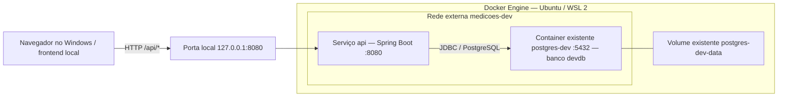

# Arquitetura Docker — contexto para o frontend

Este documento descreve o ambiente de desenvolvimento local da Medicoes API e pode ser copiado para o projeto frontend como contexto para uma IA. A configuração de referência está no `README.md`, no `compose.yaml` e no `Dockerfile` do backend. Não pressupõe React, Vue, Angular ou outra stack de frontend.

## 1. Arquitetura atual

O Docker Engine roda no Ubuntu via WSL 2. O Docker Compose deste projeto cria somente o serviço `api`, uma aplicação Spring Boot com Java 25. O PostgreSQL já existe no container `postgres-dev` e precisa estar iniciado e conectado à rede Docker externa `medicoes-dev`.



O volume `postgres-dev-data` é a persistência existente descrita no README; este Compose não cria nem gerencia o container do banco ou seu volume. Também não há serviço de frontend, proxy reverso ou configuração de produção neste Compose.

## 2. Endereços e comunicação

| Origem da chamada | Destino | Endereço |
|---|---|---|
| Navegador no Windows ou cliente HTTP no WSL | API publicada localmente | `http://localhost:8080/api` |
| Futuro proxy ou servidor frontend em container conectado à mesma rede | API pela rede Docker | `http://api:8080/api` |
| Container da API | PostgreSQL | `jdbc:postgresql://postgres-dev:5432/devdb` |

O nome `api` é resolvido entre containers na rede compartilhada. Ele não deve ser usado como URL de requisições executadas pelo navegador. Mesmo quando os arquivos do frontend são servidos por um container, o JavaScript executa no navegador e precisa de um endereço acessível por ele.

Dentro de um container, `localhost` aponta para esse próprio container. Por isso, um futuro proxy em container deve acessar `api:8080`, e não `localhost:8080`.

A publicação atual é `127.0.0.1:8080:8080`: porta 8080 do host para a porta 8080 da API, restrita ao acesso local. Ela não configura acesso a partir de outros computadores. O PostgreSQL é acessado pela API na rede Docker; o frontend não precisa de uma porta do banco publicada no host.

## 3. Integração do frontend

Mantenha a URL base configurável conforme a convenção do framework escolhido. Para chamadas diretas no desenvolvimento local, o valor é `http://localhost:8080/api`. A URL base já inclui `/api`; acrescente apenas o caminho do recurso.

```javascript
// Obtenha este valor da configuração de ambiente do frontend.
const apiBaseUrl = "http://localhost:8080/api";

async function listarClientes() {
  const response = await fetch(`${apiBaseUrl}/clientes?page=0&size=20`);
  if (!response.ok) {
    throw new Error(`Falha ao listar clientes: HTTP ${response.status}`);
  }
  return response.json();
}
```

### CORS e proxy de desenvolvimento

Não foi encontrada configuração explícita de CORS no backend. Uma página servida, por exemplo, em `http://localhost:5173` tem origem diferente de `http://localhost:8080`; chamadas diretas pelo navegador precisam de autorização CORS do backend. O exemplo acima depende dessa autorização quando houver origens diferentes.

Para integrar sem alterar o backend, configure o proxy do servidor de desenvolvimento do frontend:

- O navegador chama caminhos relativos, como `/api/clientes`.
- O servidor frontend encaminha `/api/*` para `http://localhost:8080`, preservando o prefixo `/api`, quando executado no host.
- Se esse servidor estiver em um container na rede `medicoes-dev`, o destino do proxy será `http://api:8080`.
- Nesse modelo, configure a URL base do frontend como `/api`.

O proxy é uma orientação para o projeto frontend; ele ainda não faz parte desta infraestrutura. Se optar por chamadas diretas, será necessário configurar no backend as origens permitidas. Não use `mode: "no-cors"`, pois ele não permite ler normalmente a resposta da API.

### Contrato HTTP essencial

| Recurso relativo à URL base | Métodos |
|---|---|
| `/clientes`, `/imoveis`, `/medidores` | GET e POST |
| `/clientes/{id}`, `/imoveis/{id}`, `/medidores/{id}` | GET, PUT e DELETE |
| `/instalacoes` | GET e POST |
| `/instalacoes/{id}` | GET |
| `/instalacoes/{id}/encerramento` | POST |

As listagens usam `page=0&size=20`, com páginas iniciando em zero e tamanho entre 1 e 100. A resposta contém `content`, `page`, `size`, `totalElements` e `totalPages`; os registros ficam em `content`. Instalações também aceitam filtros `clienteId`, `imovelId`, `medidorId` e `ativa`.

Criações retornam HTTP 201 com `Location`. Exclusões retornam 204, sem corpo: não tente interpretar esse retorno como JSON. PUT substitui os campos editáveis, e campos opcionais omitidos ficam nulos. Cadastros vinculados a instalações não podem ser excluídos, inclusive após o encerramento, e retornam 409.

O contrato completo dos DTOs, validações e exemplos está no arquivo `API.md` do repositório backend. Ao copiar este documento para outro projeto, disponibilize também esse contrato à IA para implementar os formulários e payloads.

## 4. Build, configuração e persistência

O `Dockerfile` usa duas etapas:

1. **Build:** imagem Eclipse Temurin JDK 25, Maven Wrapper e cache das dependências Maven. Executa o empacotamento com `-DskipTests`; o build da imagem não comprova que os testes passaram.
2. **Execução:** imagem Eclipse Temurin JRE 25, contendo o JAR em `/app/app.jar`, executado com `java -jar` por um usuário de sistema sem privilégios administrativos.

Não é necessário instalar Java ou Maven no host para construir a imagem. Alterações no backend exigem rebuild; não há montagem do código-fonte para recarga automática neste Compose.

O Compose sobrescreve os valores locais do datasource com:

| Variável do backend | Valor / origem |
|---|---|
| `SPRING_DATASOURCE_URL` | `jdbc:postgresql://postgres-dev:5432/devdb` |
| `SPRING_DATASOURCE_USERNAME` | `devuser` |
| `SPRING_DATASOURCE_PASSWORD` | Valor de `POSTGRES_PASSWORD` no `.env` do backend |

O `.env` é ignorado pelo Git e excluído do contexto de build. A senha precisa corresponder à já configurada no banco; definir essa variável não altera a senha do PostgreSQL existente. Nenhuma credencial do banco deve ser colocada no frontend, em variáveis públicas ou no JavaScript enviado ao navegador.

Na inicialização da aplicação, Flyway aplica as migrations pendentes e Hibernate valida o schema. A API depende de o banco estar disponível; este Compose não configura `depends_on` ou healthcheck para coordenar o PostgreSQL externo.

## 5. Operação local

Execute os comandos abaixo no terminal Ubuntu do WSL 2. No PowerShell, entre com `wsl.exe -d Ubuntu`.

### Preparar Docker e banco existente

```sh
docker info
docker compose version
docker start postgres-dev
docker network inspect medicoes-dev >/dev/null 2>&1 || docker network create medicoes-dev
docker network inspect medicoes-dev
```

Se `postgres-dev` não aparecer entre os containers conectados à rede, conecte-o uma vez:

```sh
docker network connect medicoes-dev postgres-dev
```

### Configurar e iniciar a API

```sh
cd /mnt/c/Users/renat/Spring/medicoes-api/medicoes-api
cp -n .env.example .env
nano .env
```

Preencha `POSTGRES_PASSWORD` com a senha existente de `devuser`. Para senhas com `$` ou `#`, envolva o valor em aspas simples no `.env`.

```sh
docker compose config --quiet
docker compose up -d --build
docker compose ps
docker compose logs -f api
```

### Verificar acesso, reconstruir e parar

```sh
curl --fail http://localhost:8080/api/clientes
docker compose up -d --build api
docker compose down
```

O `curl` deve retornar HTTP 200 com uma listagem paginada. Ele verifica o acesso HTTP, mas não valida CORS no navegador. Os comandos de rebuild e parada são operações independentes: execute conforme necessário.

`docker compose down` remove os recursos gerenciados por este projeto e mantém o PostgreSQL existente, seu volume e a rede externa. Não é necessário recriar o banco ao reiniciar o frontend ou a API.

## 6. Diagnóstico de integração

| Sintoma | Verificação / ação |
|---|---|
| Conexão recusada em `localhost:8080` | Confira `docker compose ps` e `docker compose logs api`; verifique se a API iniciou e se a porta está correta. |
| Docker indisponível | No Ubuntu, confira `docker info`; se o daemon estiver parado, use `sudo service docker start`. Para permissões de acesso, consulte o README do backend. |
| Falha de conexão com PostgreSQL | Confira se `postgres-dev` está rodando, conectado a `medicoes-dev`, e se banco, usuário e senha correspondem à configuração existente. |
| API funciona no curl, mas falha por CORS no navegador | Configure o proxy de desenvolvimento ou as origens permitidas no backend. |
| Navegador não resolve `api` ou `postgres-dev` | Use `localhost:8080` para a API local ou `/api` com proxy; os nomes Docker são internos. |
| Porta 8080 ocupada | Libere a porta ou altere a publicação para `127.0.0.1:8081:8080`; atualize a URL direta ou o destino do proxy no host. A porta interna continua 8080. |
| Falha de migration ou validação do schema | Consulte `docker compose logs api` e corrija a causa no backend/banco antes de testar o frontend. |

## 7. Orientações para a IA do frontend

- Trate este ambiente como desenvolvimento local e mantenha a URL base configurável.
- Integre por HTTP com a API; o acesso ao PostgreSQL pertence ao backend.
- Ao configurar um proxy, preserve `/api` e escolha o destino conforme ele rode no host ou na rede Docker.
- Use `API.md` como referência para payloads e regras de negócio, sem deduzi-los apenas da arquitetura.
- Não assuma que já existem frontend em container, proxy, CORS autorizado ou configuração de produção. Qualquer adição deve ser explícita no projeto correspondente.
